

 

<a href="https://drive.google.com/file/d/1Wg4sBJCw-wbwnl68sQes4tj4FEUyJxB6/view?usp=sharing">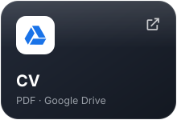</a>
<a href="PORTFOLIO_URL">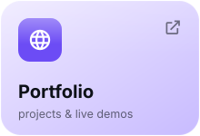</a>

## About me

I'm a final-year Applied Mathematics & Informatics student at **NPUA**, and at the same time I'm training as a software engineer at **42 Yerevan**. 42's peer-to-peer model taught me to learn on my own, read other people's code, and debug without a teacher. At **TUMO** I built an automated schedule-display system that now runs the center's information screens. I also teach C and Linux to other students, because explaining something is the best test of whether you understand it.

## Experience


## Featured project

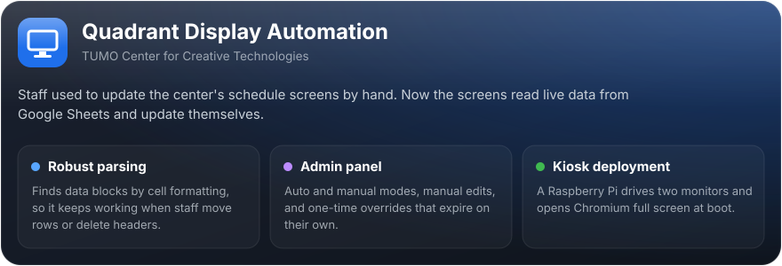

## 42 projects

<a href="https://github.com/arthavagyan/Push_swap">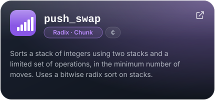</a>
<a href="https://github.com/arthavagyan/Printf">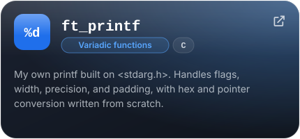</a>
<a href="https://github.com/arthavagyan/get_next_line">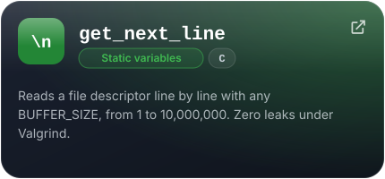</a>
<a href="https://github.com/arthavagyan/libft">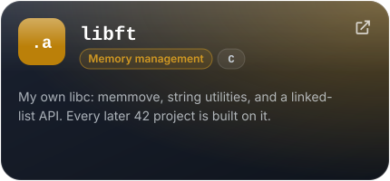</a>

## Tools

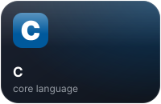
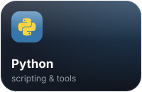
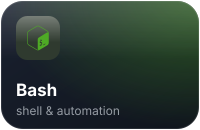
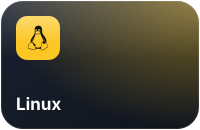
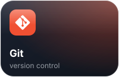
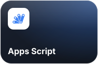
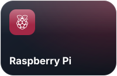
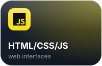

## Skills

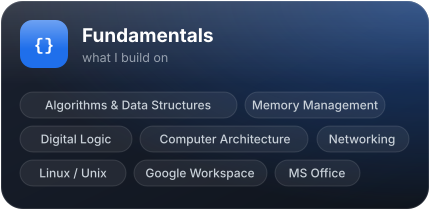
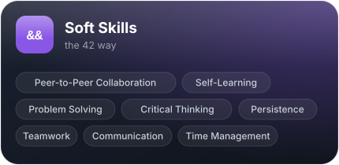

## Languages

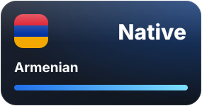
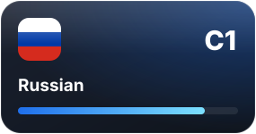
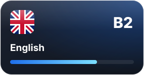

## GitHub stats

  

