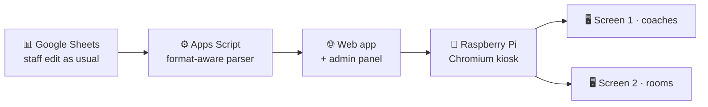

<div align="center">


<br/>

[](https://linkedin.com/in/arthavagyan)
[](mailto:arthavagy@gmail.com)
[](https://drive.google.com/file/d/1Wg4sBJCw-wbwnl68sQes4tj4FEUyJxB6/view?usp=sharing)


</div>

## `$ cat arthur.h`

```c
typedef struct s_engineer
{
    char    *name;        // "Arthur Avagyan"
    char    *based_in;    // "Yerevan, Armenia"
    char    *studying[2]; // NPUA — Applied Math & Informatics (final year)
                          // 42 Yerevan — Software Engineering
    char    *working_at;  // TUMO Center for Creative Technologies
    char    *core[3];     // { "C", "Python", "Bash" }  on  Linux/Unix
    char    *into;        // algorithms, memory management, low-level systems
    int     memory_leaks; // 0 — checked with valgrind, every time
}   t_engineer;
```

I'm a final-year Applied Mathematics & Informatics student at **NPUA**, and at the same time I'm training as a software engineer at **42 Yerevan**. 42's peer-to-peer model taught me to learn on my own, read other people's code, and debug without a teacher. At **TUMO** I built an automated schedule-display system that now runs the center's information screens. I also teach C and Linux to other students, because explaining something is the best test of whether you understand it.

## `$ ls ~/experience`

| | Role | Where | When |
|:-:|:--|:--|:--|
| 🖥️ | **Information Desk Coordinator** <br/><sub>Student & parent support, accounts and schedules, orientation meetings. Built the Quadrant Display system ↓</sub> | TUMO Center for Creative Technologies | `08/2026 — now` |
| 🧑‍🏫 | **Volunteer Instructor** <br/><sub>Taught C and Linux/Bash to large groups, organized events, proctored exams</sub> | 42 Yerevan & TUMO Labs | `08/2026 — now` |
| 🌐 | **Technical Support Specialist** <br/><sub>Troubleshot routers, Wi-Fi, LAN, and basic network configs</sub> | Ucom | `06/2025 — 04/2026` |
| ⛺ | **Volunteer Mentor** <br/><sub>Supervised and mentored children of different age groups</sub> | Children's Summer Camp | `07/2024, 07/2025` |

## `$ ./featured`

### 📺 Quadrant Display Automation (TUMO)


Staff used to update the center's schedule screens by hand. Now the screens read live data from Google Sheets and update themselves.



- **Robust parsing.** The parser finds data blocks by cell formatting, so it doesn't break when staff move rows or delete headers.
- **Admin panel.** Auto and manual modes, manual edits, and one-time overrides that expire on their own.
- **Kiosk deployment.** A Raspberry Pi drives two monitors and opens Chromium full screen at boot.

## `$ ls ~/42`

<table>
<tr>
<td width="50%" valign="top">

### [🔀 push_swap](https://github.com/arthavagyan/Push_swap)
 

Sorts a stack of integers with two stacks and a limited set of operations, in the **minimum number of moves**. Includes a bitwise radix sort on stacks.

</td>
<td width="50%" valign="top">

### [🖨️ ft_printf](https://github.com/arthavagyan/Printf)
 

My own `printf` built on `<stdarg.h>`. Handles flags, width, precision, and padding, with hex and pointer conversion written from scratch.

</td>
</tr>
<tr>
<td width="50%" valign="top">

### [📄 get_next_line](https://github.com/arthavagyan/get_next_line)
 

Reads a file descriptor line by line with any `BUFFER_SIZE`, from 1 to 10,000,000. **Zero leaks** under Valgrind.

</td>
<td width="50%" valign="top">

### [🧱 libft](https://github.com/arthavagyan/libft)
 

My own libc: `memmove`, string utilities, and a linked-list API. Every later 42 project is built on it.

</td>
</tr>
</table>

## `$ which tools`

<div align="center">


<br/><br/>


</div>

<table>
<tr>
<td width="50%" valign="top">

**🧠 Fundamentals**

`Algorithms & Data Structures` `Memory Management`
`Digital Logic` `Computer Architecture`
`Networking` `Linux / Unix`

</td>
<td width="50%" valign="top">

**🤝 How I work**

`Peer-to-Peer Collaboration` `Self-Learning`
`Problem Solving` `Critical Thinking` `Persistence`
`Teamwork` `Communication` `Time Management`

</td>
</tr>
</table>

## `$ locale -a`

| Language | Level | |
|:--|:-:|:--|
| 🇦🇲 Armenian | Native | `██████████` |
| 🇷🇺 Russian | C1 | `████████░░` |
| 🇬🇧 English | B2 | `███████░░░` |

## `$ git log --stat`

<div align="center">


<br/><br/>


</div>
