

<picture><source media="(max-width: 700px)" srcset="assets/m/header.svg"></picture>

<a href="mailto:arthavagy@gmail.com"><picture><source media="(max-width: 700px)" srcset="assets/m/contact-gmail.svg"></picture></a>
<a href="https://linkedin.com/in/arthavagyan"><picture><source media="(max-width: 700px)" srcset="assets/m/contact-linkedin.svg"></picture></a>
<a href="https://drive.google.com/file/d/1hkDk9E3DVlUaQk5yTPsfIpyKj-EujGdM/view?usp=sharing"><picture><source media="(max-width: 700px)" srcset="assets/m/contact-cv.svg">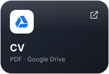</picture></a>
<a href="PORTFOLIO_URL"><picture><source media="(max-width: 700px)" srcset="assets/m/contact-portfolio.svg">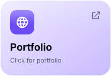</picture></a>

## About me

I'm a final-year Applied Mathematics & Informatics student at **NPUA**, and at the same time I'm training as a software engineer at **42 Yerevan**. 42's peer-to-peer model taught me to learn on my own, read other people's code, and debug without a teacher. At **TUMO** I built an automated schedule-display system that now runs the center's information screens. I also teach C and Linux to other students, because explaining something is the best test of whether you understand it.

## Experience

<picture><source media="(max-width: 700px)" srcset="assets/m/experience.svg"></picture>

## Featured project

<picture><source media="(max-width: 700px)" srcset="assets/m/featured.svg">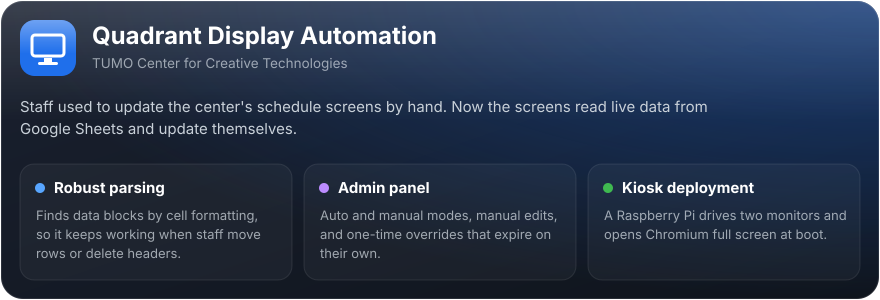</picture>

## 42 projects

<a href="https://github.com/arthavagyan/Push_swap"><picture><source media="(max-width: 700px)" srcset="assets/m/project-push_swap.svg">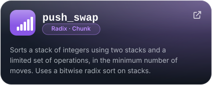</picture></a>
<a href="https://github.com/arthavagyan/Printf"><picture><source media="(max-width: 700px)" srcset="assets/m/project-printf.svg">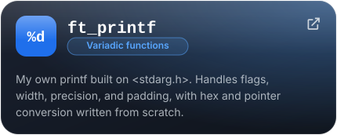</picture></a>
<a href="https://github.com/arthavagyan/get_next_line"><picture><source media="(max-width: 700px)" srcset="assets/m/project-gnl.svg">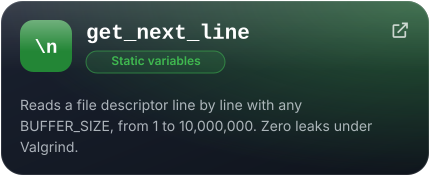</picture></a>
<a href="https://github.com/arthavagyan/libft"><picture><source media="(max-width: 700px)" srcset="assets/m/project-libft.svg">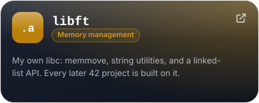</picture></a>

## Tools

<picture><source media="(max-width: 700px)" srcset="assets/m/tool-c.svg">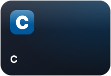</picture>
<picture><source media="(max-width: 700px)" srcset="assets/m/tool-python.svg">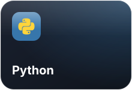</picture>
<picture><source media="(max-width: 700px)" srcset="assets/m/tool-bash.svg">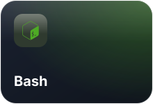</picture>
<picture><source media="(max-width: 700px)" srcset="assets/m/tool-linux.svg">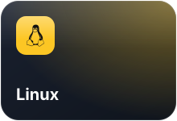</picture>
<picture><source media="(max-width: 700px)" srcset="assets/m/tool-git.svg">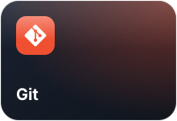</picture>
<picture><source media="(max-width: 700px)" srcset="assets/m/tool-appsscript.svg">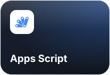</picture>
<picture><source media="(max-width: 700px)" srcset="assets/m/tool-raspberrypi.svg">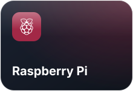</picture>
<picture><source media="(max-width: 700px)" srcset="assets/m/tool-js.svg">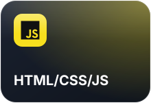</picture>

## Skills

<picture><source media="(max-width: 700px)" srcset="assets/m/skills-hard.svg">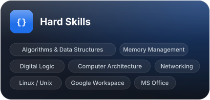</picture>
<picture><source media="(max-width: 700px)" srcset="assets/m/skills-soft.svg">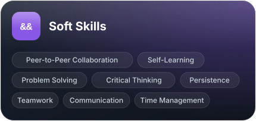</picture>

## Languages

<picture><source media="(max-width: 700px)" srcset="assets/m/lang-hy.svg">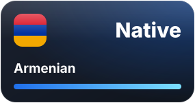</picture>
<picture><source media="(max-width: 700px)" srcset="assets/m/lang-ru.svg">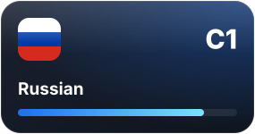</picture>
<picture><source media="(max-width: 700px)" srcset="assets/m/lang-en.svg">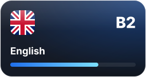</picture>

## GitHub stats

  

<picture><source media="(max-width: 700px)" srcset="assets/m/footer.svg"></picture>

